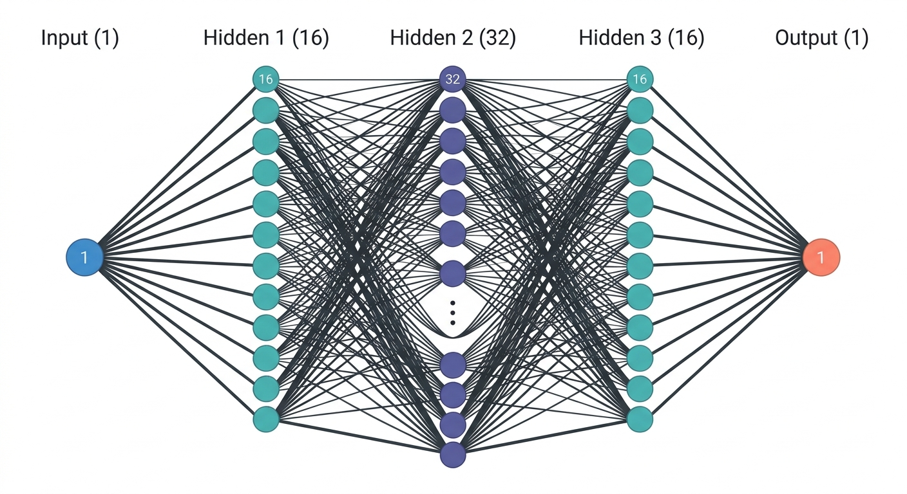
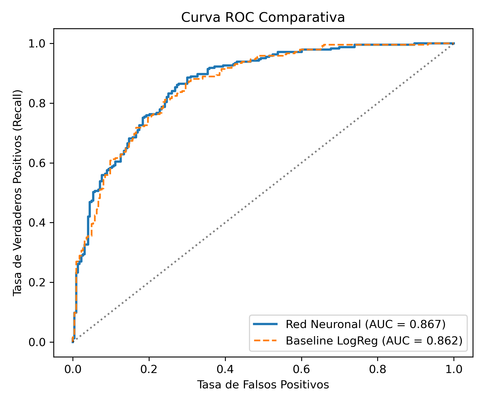
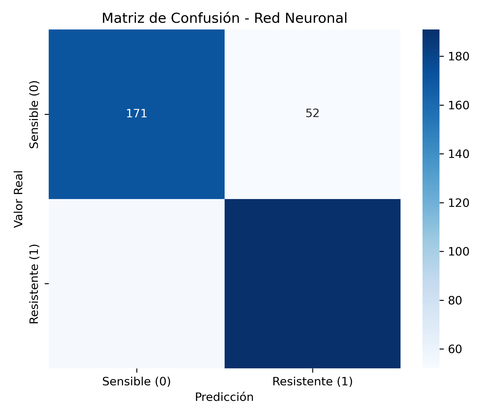
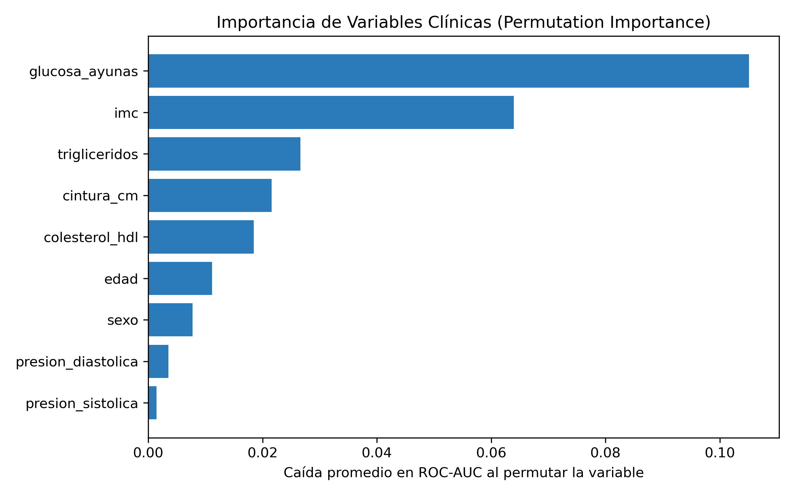

# Predicción de Resistencia a la Insulina con Redes Neuronales (PyTorch)

Modelo de Deep Learning (**Perceptrón Multicapa - MLP**) entrenado con datos clínicos reales de la encuesta nacional de salud **NHANES (CDC, ciclo 2017-2018)** para identificar individuos con resistencia a la insulina utilizando únicamente variables antropométricas y análisis de sangre de rutina, sin necesidad de medir insulina basal en laboratorio.

## Motivación Clínica
La medición directa de insulina en sangre es costosa y no forma parte de los chequeos médicos de rutina. Este proyecto demuestra cómo una red neuronal puede estimar el riesgo de resistencia a la insulina (definida mediante el índice clínico **HOMA-IR > 2.5**) a partir de indicadores accesibles como circunferencia de cintura, IMC, glucosa en ayunas, triglicéridos, colesterol HDL, presión arterial, edad y sexo.

## Pipeline de Datos y Prevención de *Data Leakage*
1. **Cruce de tablas NHANES (`SEQN`):** Integración de datos demográficos (`DEMO_J`), examen físico (`BMX_J`, `BPX_J`) y laboratorio (`GLU_J`, `INS_J`, `HDL_J`, `TRIGLY_J`).
2. **Filtrado clínico:** Selección de adultos ($\ge 18$ años) con ayuno confirmado de 8 a 24 horas (`WTSAF2YR > 0`).
3. **Etiquetado y aislamiento:** Cálculo de `HOMA-IR = (Glucosa * Insulina) / 405` para generar la variable objetivo binaria (`1` si HOMA-IR > 2.5, `0` en caso contrario), eliminando posteriormente la columna de insulina para evitar fuga de datos.
4. **Preprocesamiento estricto:** División estratificada (80% entrenamiento / 20% prueba) seguida de imputación por mediana y estandarización (`StandardScaler`) ajustadas exclusivamente sobre el conjunto de entrenamiento.

## Arquitectura del Modelo (PyTorch)
* **Capas ocultas:** 2 capas densas (`32` y `16` neuronas) con activación `ReLU`.
* **Regularización:** `BatchNorm1d` y `Dropout` (`0.3` y `0.2`) + `weight_decay=1e-4` para prevenir sobreajuste en datos tabulares.
* **Función de pérdida y optimizador:** `BCEWithLogitsLoss` con optimizador `Adam` (`lr=0.001`).

## Estructura de la red neuronal


## Resultados y Explicabilidad

| Modelo | ROC-AUC | 
| :--- | :---: |
| Baseline (Regresión Logística) | *0.867* | 
| **Red Neuronal (MLP - PyTorch)** | **0.862** |

### Curva ROC y Matriz de Confusión



### Importancia de Variables Clínicas (*Permutation Importance*)
El análisis de permutación confirma coherencia fisiopatológica: las variables con mayor impacto en la predicción son la circunferencia de cintura, el IMC, la glucosa en ayunas y los triglicéridos.



## Cómo ejecutar el proyecto
```bash
git clone https://github.com
cd insulin-resistance-nn
pip install -r requirements.txt
```
